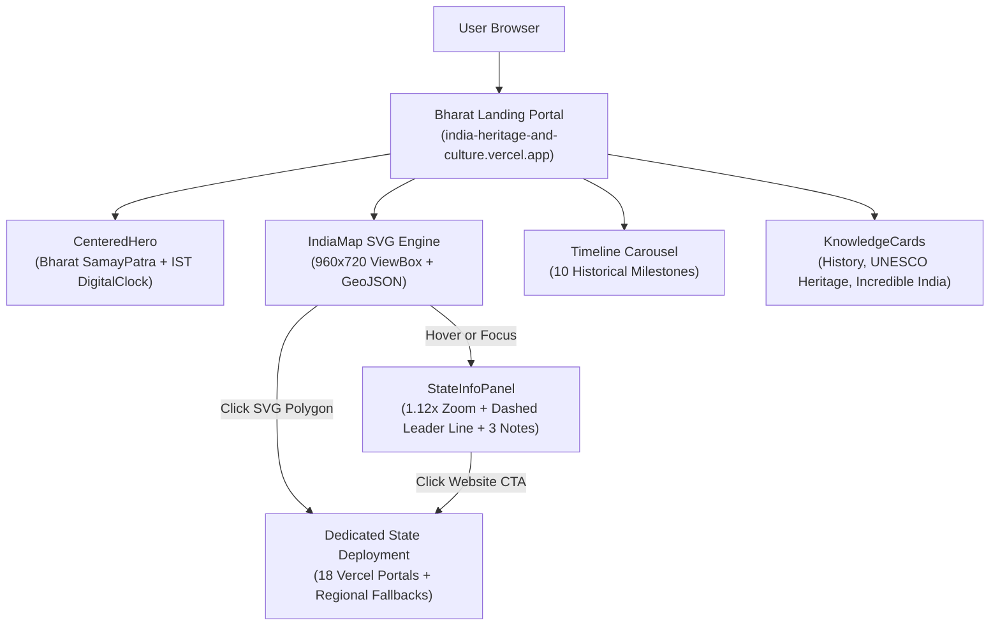

# Project Report: India Heritage and Culture Portal (`India_HNC_Main`)

---

## Table of Contents

- [Document Control and Metadata](#document-control-and-metadata)
- [1. Executive Summary and Abstract](#1-executive-summary-and-abstract)
- [2. Problem Statement and Project Objectives](#2-problem-statement-and-project-objectives)
  - [2.1 Problem Statement](#21-problem-statement)
  - [2.2 Core Objectives](#22-core-objectives)
- [3. System Architecture and Technology Stack](#3-system-architecture-and-technology-stack)
  - [3.1 Architecture Overview](#31-architecture-overview)
  - [3.2 Complete Technology Stack and Dependencies](#32-complete-technology-stack-and-dependencies)
  - [3.3 Repository Directory Structure](#33-repository-directory-structure)
- [4. Component and UI Architecture](#4-component-and-ui-architecture)
  - [4.1 Application Shell and Routing](#41-application-shell-and-routing)
  - [4.2 Visual Components and Telemetry](#42-visual-components-and-telemetry)
  - [4.3 Backend Express Server Architecture](#43-backend-express-server-architecture)
  - [4.4 Standalone HTML5 Prototypes](#44-standalone-html5-prototypes)
- [5. Data Dictionary and Object Model Specifications](#5-data-dictionary-and-object-model-specifications)
  - [5.1 StateInfo Object](#51-stateinfo-object)
  - [5.2 MapShape Object](#52-mapshape-object)
  - [5.3 GeoJSON Feature Hierarchy Objects](#53-geojson-feature-hierarchy-objects)
  - [5.4 TimelineItem and KnowledgeCard Objects](#54-timelineitem-and-knowledgecard-objects)
  - [5.5 Shared API Response Object](#55-shared-api-response-object)
- [6. Exhaustive State and Regional Object Catalog](#6-exhaustive-state-and-regional-object-catalog)
  - [6.1 Summary Matrix of Configured Deployments](#61-summary-matrix-of-configured-deployments)
  - [6.2 Detailed Object Specifications for Vercel-Wired States](#62-detailed-object-specifications-for-vercel-wired-states)
  - [6.3 Additional Pre-Configured Regions and Fallback Object](#63-additional-pre-configured-regions-and-fallback-object)
- [7. Interactive Map Engine and Routing Mechanics](#7-interactive-map-engine-and-routing-mechanics)
  - [7.1 GeoJSON Loading and Coordinate Projection](#71-geojson-loading-and-coordinate-projection)
  - [7.2 Vertex Centroid Calculation and Territory Overlays](#72-vertex-centroid-calculation-and-territory-overlays)
  - [7.3 Tricolor Palette Hashing](#73-tricolor-palette-hashing)
  - [7.4 Dual-Action Routing and Hover Overlay](#74-dual-action-routing-and-hover-overlay)
- [8. Engineering Challenges and Solutions](#8-engineering-challenges-and-solutions)
- [9. DevOps, Build Pipelines, and Deployment](#9-devops-build-pipelines-and-deployment)
  - [9.1 Build Scripts and Local Development](#91-build-scripts-and-local-development)
  - [9.2 Vercel Cloud Deployment Configuration](#92-vercel-cloud-deployment-configuration)
  - [9.3 Developer Guide for Adding New States](#93-developer-guide-for-adding-new-states)
- [10. Verification and Operational Status](#10-verification-and-operational-status)
- [11. Conclusion and Future Scope](#11-conclusion-and-future-scope)

---

## Document Control and Metadata

| Attribute | Value |
|---|---|
| **Project Title** | India Heritage and Culture Portal (*Bharat SamayPatra*) |
| **Package Identifier** | `india-heritage-and-culture` (`private: true`, `type: "module"`) |
| **Repository URL** | [https://github.com/shresthasrii/India_HNC_Main.git](https://github.com/shresthasrii/India_HNC_Main.git) (Branch: `main`) |
| **Production URL** | [https://india-heritage-and-culture.vercel.app/](https://india-heritage-and-culture.vercel.app/) |
| **Local Workspace** | `C:\Users\sriis\Documents\Final\INDIA_INC` |
| **Local Dev Endpoint** | `http://localhost:8081/` (Express API at `/api/ping`, `/api/demo`) |
| **Primary Stack** | React 18.3.1, TypeScript 5.9.2, Vite 7.1.2, Express 5.1.0, Tailwind CSS 3.4.17 |
| **GeoJSON Source** | Highcharts India Disputed Map (`in-all-disputed.geo.json`) |

---

## 1. Executive Summary and Abstract

The **India Heritage and Culture Portal** (*Bharat SamayPatra*) is a full-stack React + TypeScript Single Page Application (SPA) backed by an Express 5 API layer. It serves as the central interactive directory for exploring India's geographic states, Union Territories, historical milestones, and regional cultural deployments.

At the heart of the application is a custom vector SVG map engine (`IndiaMap`) that dynamically fetches GeoJSON boundary coordinates, projects polygons onto a `960x720` SVG viewport, shades regions using an Indian tricolor-inspired hash palette, and elevates individual states on hover with an animated info panel (`StateInfoPanel`). Users can navigate to dedicated state web portals either by clicking a state boundary directly (`StateShape`) or by clicking the anchored hover details card (`StateInfoPanel`).



---

## 2. Problem Statement and Project Objectives

### 2.1 Problem Statement
Digital documentation of India's culture—spanning 22 scheduled languages, diverse classical dance forms, regional festivals, and UNESCO World Heritage Sites—is distributed across disconnected state portals and standalone regional micro-apps. Without a unified spatial interface, visitors cannot smoothly discover highlights across states or navigate directly from a national overview to state-specific web applications.

### 2.2 Core Objectives
1. **Interactive Spatial Exploration**: Render India's states and Union Territories in an accessible, responsive SVG map featuring hover elevation (`1.12x` centroid-anchored scaling) and deterministic tricolor styling.
2. **Multi-Key State Resolution**: Standardize lookup logic across inconsistent GeoJSON identifiers (`hc-key`, ISO-style `in-xx` codes, full state names, and legacy spellings such as `"orissa"`, `"kerela"`, or `"telengana"`).
3. **Dual-Action Navigation Hub**: Wire **18 deployed Vercel state portals** (plus **8 regional/reference entries** and a dynamic search fallback) into both map polygons (`StateShape`) and anchored side panels (`StateInfoPanel`).
4. **Historical and Educational Context**: Complement spatial navigation with a 10-event historical milestone carousel (`Timeline`) and 3 curated educational knowledge cards (`KnowledgeCards`).
5. **Production-Ready Cloud Hosting**: Provide reproducible local execution (`vite` on port `8081`), Express production serving (`dist/server` + `dist/spa`), and clean SPA routing on Vercel (`vercel.json`).

---

## 3. System Architecture and Technology Stack

### 3.1 Architecture Overview
The project follows a decoupled client-server repository layout compiled via Vite:
- **Client SPA (`client/`)**: Compiled by `vite build` into `dist/spa/` (consumed directly by Vercel in production or by Express in self-hosted Node deployments).
- **Server (`server/`)**: Express 5 application (`createServer()` in [server/index.ts](file:///C:/Users/sriis/Documents/Final/INDIA_INC/server/index.ts)) integrated into Vite dev mode via a custom `expressPlugin()` in [vite.config.ts](file:///C:/Users/sriis/Documents/Final/INDIA_INC/vite.config.ts), and compiled separately via [vite.config.server.ts](file:///C:/Users/sriis/Documents/Final/INDIA_INC/vite.config.server.ts) to `dist/server/`.
- **Shared (`shared/`)**: Cross-environment TypeScript API contracts (`DemoResponse` in [shared/api.ts](file:///C:/Users/sriis/Documents/Final/INDIA_INC/shared/api.ts)).
- **Standalone Prototypes (`India_Heritage_and_Culture/`)**: Vanilla HTML/CSS/JS preview stages (`initial/`, `part 2/`, `part 3/`, `final/`) kept synchronized with the React state URL catalog.

### 3.2 Complete Technology Stack and Dependencies
Verified directly from [package.json](file:///C:/Users/sriis/Documents/Final/INDIA_INC/package.json):

| Category | Packages & Exact Declared Versions |
|---|---|
| **Runtime & Package Manager** | Node.js ES Modules (`"type": "module"`), `pnpm@10.14.0`, `tsx` (`^4.20.3`) |
| **Core UI Framework** | `react` (`^18.3.1`), `react-dom` (`^18.3.1`), `typescript` (`^5.9.2`) |
| **Build & Compiler** | `vite` (`^7.1.2`), `@vitejs/plugin-react-swc` (`^4.0.0`), `@swc/core` (`^1.13.3`) |
| **Client Routing & State** | `react-router-dom` (`^6.30.1`), `@tanstack/react-query` (`^5.84.2`) |
| **Styling & Design System** | `tailwindcss` (`^3.4.17`), `@tailwindcss/typography` (`^0.5.16`), `tailwindcss-animate` (`^1.0.7`), `postcss` (`^8.5.6`), `autoprefixer` (`^10.4.21`), `class-variance-authority` (`^0.7.1`), `clsx` (`^2.1.1`), `tailwind-merge` (`^2.6.0`), `next-themes` (`^0.4.6`) |
| **UI Component Primitives** | 26 `@radix-ui/react-*` packages (Accordion, AlertDialog, AspectRatio, Avatar, Checkbox, Collapsible, ContextMenu, Dialog, DropdownMenu, HoverCard, Label, Menubar, NavigationMenu, Popover, Progress, RadioGroup, ScrollArea, Select, Separator, Slider, Slot, Switch, Tabs, Toast, Toggle, ToggleGroup, Tooltip), `cmdk` (`^1.1.1`), `vaul` (`^1.1.2`), `sonner` (`^1.7.4`), `input-otp` (`^1.4.2`), `react-resizable-panels` (`^3.0.4`), `react-day-picker` (`^9.8.1`), `date-fns` (`^4.1.0`) |
| **Carousel, Motion & Graphics** | `embla-carousel-react` (`^8.6.0`), `framer-motion` (`^12.23.12`), `lucide-react` (`^0.539.0`), `recharts` (`^2.12.7`), `three` (`^0.176.0`), `@react-three/fiber` (`^8.18.0`), `@react-three/drei` (`^9.122.0`) |
| **Backend API & Validation** | `express` (`^5.1.0`), `cors` (`^2.8.5`), `dotenv` (`^17.2.1`), `zod` (`^3.25.76`), `serverless-http` (`^3.2.0`), `react-hook-form` (`^7.62.0`), `@hookform/resolvers` (`^5.2.1`) |
| **Testing & Code Quality** | `vitest` (`^3.2.4`), `prettier` (`^3.6.2`) |

### 3.3 Repository Directory Structure
```text
INDIA_INC/
├── client/
│   ├── components/
│   │   ├── home/
│   │   │   └── KnowledgeCards.tsx        # 3-card educational grid
│   │   ├── icons/
│   │   │   └── ChakraIcon.tsx            # 24-spoke SVG Ashoka Chakra icon
│   │   ├── layout/
│   │   │   ├── Header.tsx                # Sticky header (Home, About, Incredible India)
│   │   │   └── Footer.tsx                # Footer with GeoJSON & MyGov references
│   │   ├── map/
│   │   │   ├── StateShape.tsx            # Individual clickable SVG state path + URL resolver
│   │   │   └── StateInfoPanel.tsx        # 1.12x zoomed overlay + leader line + 260x140 card
│   │   ├── timeline/
│   │   │   └── TimelineCard.tsx          # Linked milestone slide card
│   │   ├── ui/                           # Reusable Radix/Tailwind UI components
│   │   ├── AnalogClock.tsx               # 60x60 SVG IST clock component
│   │   ├── CenteredHero.css              # Hero twinkle & animation styles
│   │   ├── CenteredHero.tsx              # "Bharat SamayPatra" hero + starfield + clock
│   │   ├── DigitalClock.tsx              # Live Asia/Kolkata HH:MM:SS clock
│   │   ├── IndiaBackground.tsx           # Fixed tricolor ambient glows + paisley + chakras
│   │   ├── IndiaMap.tsx                  # Core SVG map container & GeoJSON projector
│   │   └── Timeline.tsx                  # Embla auto-playing historical carousel
│   ├── data/
│   │   ├── knowledgeCards.ts             # KNOWLEDGE_CARDS array (3 cards)
│   │   ├── stateInfo.ts                  # STATE_INFO dictionary (62 keys) + fallback helper
│   │   └── timelineEvents.ts             # TIMELINE_EVENTS array (10 milestones)
│   ├── hooks/
│   │   ├── useGeoJSON.ts                 # Async GeoJSON fetch hook with mount guard
│   │   ├── use-mobile.tsx
│   │   └── use-toast.ts
│   ├── lib/
│   │   ├── assets.ts                     # Builder CDN URLs for timeline imagery
│   │   ├── mapUtils.ts                   # FLAG_COLORS, colorForKey, normalizeKey, computeBounds, centroidOfFeature
│   │   ├── utils.ts
│   │   └── utils.spec.ts
│   ├── pages/
│   │   ├── Index.tsx                     # Main landing page composing Hero, Map, Timeline, Cards
│   │   ├── About.tsx                     # "/about" informational page
│   │   └── NotFound.tsx                  # Catch-all 404 route logger & redirect
│   ├── types/
│   │   ├── map.ts                        # Position, Feature*, StateKey, StateInfo, MapShape, IndiaMapProps
│   │   └── timeline.ts                   # TimelineItem interface
│   ├── App.tsx                           # BrowserRouter, QueryClientProvider, Toaster, Routes
│   └── global.css                        # Inter font import + Tailwind CSS HSL theme tokens
├── public/
│   ├── in-all-disputed.geo.json          # Local GeoJSON copy
│   ├── flag.svg, favicon.ico, placeholder.svg, robots.txt
├── server/
│   ├── routes/
│   │   └── demo.ts                       # GET /api/demo handler returning DemoResponse
│   ├── index.ts                          # createServer() Express factory (/api/ping, /api/demo)
│   └── node-build.ts                     # Production Express static SPA server (port 3000 default)
├── shared/
│   └── api.ts                            # Shared DemoResponse type
├── India_Heritage_and_Culture/           # Standalone progressive HTML/CSS/JS builds
│   ├── initial/, part 2/, part 3/, final/, run_preview.bat
├── .builder/, index.html, package.json, pnpm-lock.yaml, tsconfig.json
├── vite.config.ts, vite.config.server.ts, tailwind.config.ts, components.json
├── vercel.json, netlify.toml, run.bat, run.ps1, .gitignore
└── PROJECT_REPORT.md
```

---

## 4. Component and UI Architecture

### 4.1 Application Shell and Routing
In [client/App.tsx](file:///C:/Users/sriis/Documents/Final/INDIA_INC/client/App.tsx), the root component wraps the interface in `QueryClientProvider`, `TooltipProvider`, `Toaster`, `Sonner`, and `BrowserRouter`. It mounts persistent background, navigation, and footer layers around three routes:
- `/` &rarr; `Index` ([client/pages/Index.tsx](file:///C:/Users/sriis/Documents/Final/INDIA_INC/client/pages/Index.tsx))
- `/about` &rarr; `About` ([client/pages/About.tsx](file:///C:/Users/sriis/Documents/Final/INDIA_INC/client/pages/About.tsx))
- `*` &rarr; `NotFound` ([client/pages/NotFound.tsx](file:///C:/Users/sriis/Documents/Final/INDIA_INC/client/pages/NotFound.tsx))

### 4.2 Visual Components and Telemetry
- **`IndiaBackground` ([client/components/IndiaBackground.tsx](file:///C:/Users/sriis/Documents/Final/INDIA_INC/client/components/IndiaBackground.tsx))**: Renders a fixed backdrop (`-z-10`) featuring soft saffron (`rgba(255,103,31,0.18)`) and green (`rgba(19,136,8,0.18)`) radial gradients, an SVG `<pattern id="paisley">` (`160x160`), and four 24-spoke `Chakra` motifs.
- **`CenteredHero` ([client/components/CenteredHero.tsx](file:///C:/Users/sriis/Documents/Final/INDIA_INC/client/components/CenteredHero.tsx))**: Displays 50 procedurally positioned twinkling star elements, two rotating `ChakraIcon` emblems (`size={40}`), the title `"Bharat SamayPatra"`, and a live `DigitalClock`.
- **`DigitalClock` ([client/components/DigitalClock.tsx](file:///C:/Users/sriis/Documents/Final/INDIA_INC/client/components/DigitalClock.tsx))**: Polls every `1000ms` and formats Indian Standard Time via `toLocaleString("en-US", { timeZone: "Asia/Kolkata" })` into `HH:MM:SS` (`IST`).
- **`AnalogClock` ([client/components/AnalogClock.tsx](file:///C:/Users/sriis/Documents/Final/INDIA_INC/client/components/AnalogClock.tsx))**: Available `60x60` SVG timepiece calculating `UTC+5:30` hand angles (`#0B5CAB` hour, `#1A9B0A` minute, `#FF671F` second).
- **`Timeline` ([client/components/Timeline.tsx](file:///C:/Users/sriis/Documents/Final/INDIA_INC/client/components/Timeline.tsx))**: Uses `embla-carousel-react` (`loop: true`, `align: "center"`, `inViewThreshold: 0.6`) with `requestAnimationFrame`-driven auto-play every `3500ms`, hover pause, previous/next buttons, and keyboard `ArrowLeft`/`ArrowRight` navigation across 10 milestones in [timelineEvents.ts](file:///C:/Users/sriis/Documents/Final/INDIA_INC/client/data/timelineEvents.ts):
  1. `c. 2600–1900 BCE` — Indus Valley Civilisation
  2. `c. 250 BCE` — Ashoka & Mauryan Edicts
  3. `c. 1600–1707` — Height of Mughal Empire
  4. `1857` — First War of Independence
  5. `1919` — Jallianwala Bagh
  6. `1930` — Dandi March
  7. `15 Aug 1947` — Independence of India
  8. `26 Jan 1950` — Republic of India
  9. `1971` — Bangladesh Liberation
  10. `2014` — Mars Orbiter Mission
- **`KnowledgeCards` ([client/components/home/KnowledgeCards.tsx](file:///C:/Users/sriis/Documents/Final/INDIA_INC/client/components/home/KnowledgeCards.tsx))**: Renders 3 external educational resource cards from [knowledgeCards.ts](file:///C:/Users/sriis/Documents/Final/INDIA_INC/client/data/knowledgeCards.ts): *History of India* (Wikipedia), *Heritage of India* (UNESCO World Heritage Centre), and *Cultural Data & Diversity* (Incredible India).

### 4.3 Backend Express Server Architecture
- **`createServer` ([server/index.ts](file:///C:/Users/sriis/Documents/Final/INDIA_INC/server/index.ts))**: Configures `cors()`, `express.json()`, and `express.urlencoded({ extended: true })`, exposing:
  - `GET /api/ping` &rarr; returns `{ message: process.env.PING_MESSAGE ?? "ping" }` (`"ping pong"` in `.env`)
  - `GET /api/demo` &rarr; delegates to `handleDemo` ([server/routes/demo.ts](file:///C:/Users/sriis/Documents/Final/INDIA_INC/server/routes/demo.ts)) returning `{ message: "Hello from Express server" }`
- **Production Entry ([server/node-build.ts](file:///C:/Users/sriis/Documents/Final/INDIA_INC/server/node-build.ts))**: Serves static assets from `path.join(__dirname, "../spa")` (`dist/spa`), returns JSON 404 for unknown `/api/*` or `/health` routes, falls back to `dist/spa/index.html` for all SPA routes, and handles `SIGTERM`/`SIGINT` graceful shutdown.

### 4.4 Standalone HTML5 Prototypes
The directory `India_Heritage_and_Culture/` houses progressive standalone builds (`initial/`, `part 2/`, `part 3/`, `final/`) launchable via `run_preview.bat`. The `final/` and `part 3/` stages contain pre-projected SVG paths and a synchronized `STATE_INFO` table inside `map-data.js` wired with the same 18 Vercel URLs as the React client.

---

## 5. Data Dictionary and Object Model Specifications

Every data structure powering the map, UI widgets, and API responses is strongly typed under `client/types/` and `shared/`.

### 5.1 StateInfo Object
Defined in [client/types/map.ts](file:///C:/Users/sriis/Documents/Final/INDIA_INC/client/types/map.ts#L31-L37) and stored in `STATE_INFO: Record<StateKey, StateInfo>` inside [client/data/stateInfo.ts](file:///C:/Users/sriis/Documents/Final/INDIA_INC/client/data/stateInfo.ts):

```typescript
export type StateKey = string;

export interface StateInfo {
  name: string;        // Official state/UT display title rendered in ARIA labels and StateInfoPanel
  tourismUrl: string;  // Target portal URL opened in a new tab (_blank, noopener noreferrer)
  notes: string[];     // Array of 3 heritage bullet strings displayed on hover
}
```

### 5.2 MapShape Object
Defined in [client/types/map.ts](file:///C:/Users/sriis/Documents/Final/INDIA_INC/client/types/map.ts#L39-L50) and generated inside `IndiaMap`:

```typescript
export interface MapShape {
  key: string;                        // Normalized lowercase key (hc-key or "in-<slug>")
  name: string;                       // Feature name or uppercase key fallback
  d: string;                          // Projected SVG path commands ("M... L... Z")
  centroid: { x: number; y: number }; // Projected viewport coordinates for zoom & leader-line anchor
  isCircle?: boolean;                 // True for circular disputed-territory overlays (PoK, Aksai Chin)
}

export interface IndiaMapProps {
  width?: number;   // Default: 960 SVG user units
  height?: number;  // Default: 720 SVG user units
}
```

### 5.3 GeoJSON Feature Hierarchy Objects
Defined in [client/types/map.ts](file:///C:/Users/sriis/Documents/Final/INDIA_INC/client/types/map.ts#L1-L29):

```typescript
export interface Position {
  0: number; // Longitude
  1: number; // Latitude
}

export type PolygonCoords = Position[];
export type MultiPolygonCoords = (PolygonCoords | PolygonCoords[])[];

export interface FeatureGeometry {
  type: "Polygon" | "MultiPolygon";
  coordinates: any;
}

export interface FeatureProperties {
  name?: string;
  "hc-key"?: string;
}

export interface Feature {
  type: "Feature";
  id?: string;
  properties: FeatureProperties;
  geometry: FeatureGeometry;
}

export interface FeatureCollection {
  type: "FeatureCollection";
  features: Feature[];
}
```

### 5.4 TimelineItem and KnowledgeCard Objects
Defined in [client/types/timeline.ts](file:///C:/Users/sriis/Documents/Final/INDIA_INC/client/types/timeline.ts) and [client/data/knowledgeCards.ts](file:///C:/Users/sriis/Documents/Final/INDIA_INC/client/data/knowledgeCards.ts):

```typescript
export interface TimelineItem {
  date: string;   // Era or historical date label (e.g., "15 Aug 1947")
  title: string;  // Milestone heading
  image: string;  // Asset URL from ASSETS
  href?: string;  // External Wikipedia reference link
  alt: string;    // Image accessibility description
}

export interface KnowledgeCard {
  title: string;       // Card heading
  description: string; // Summary paragraph
  linkText: string;    // CTA label with arrow
  linkUrl: string;     // External educational URL
}
```

### 5.5 Shared API Response Object
Defined in [shared/api.ts](file:///C:/Users/sriis/Documents/Final/INDIA_INC/shared/api.ts):

```typescript
export interface DemoResponse {
  message: string;
}
```

---

## 6. Exhaustive State and Regional Object Catalog

Currently, [client/data/stateInfo.ts](file:///C:/Users/sriis/Documents/Final/INDIA_INC/client/data/stateInfo.ts) defines **62 key mappings** representing **26 distinct geographic entities** (18 states/UTs wired directly to dedicated Vercel deployments in both `StateShape.tsx` and `StateInfoPanel.tsx`, plus 8 additional regions pointing to official tourism/reference links), supplemented by a dynamic fallback function `getStateFallbackInfo`.

### 6.1 Summary Matrix of Configured Deployments

| # | State / UT | Primary Key | Live Vercel Redirection URL | Wired in Map Components |
|---|---|---|---|---|
| 1 | **Jammu & Kashmir** | `in-jk` | [https://india-inc-jnk-l.vercel.app/](https://india-inc-jnk-l.vercel.app/) | `isJK` (`StateShape`, `StateInfoPanel`) |
| 2 | **Uttarakhand** | `in-ut` | [https://india-inc-ut.vercel.app/](https://india-inc-ut.vercel.app/) | `isUT` (`StateShape`, `StateInfoPanel`) |
| 3 | **Jharkhand** | `in-jh` | [https://india-inc-jk.vercel.app/](https://india-inc-jk.vercel.app/) | `isJH` (`StateShape`, `StateInfoPanel`) |
| 4 | **Karnataka** | `in-ka` | [https://india-inc-kt.vercel.app/](https://india-inc-kt.vercel.app/) | `isKA` (`StateShape`, `StateInfoPanel`) |
| 5 | **Uttar Pradesh** | `in-up` | [https://india-inc-up.vercel.app/](https://india-inc-up.vercel.app/) | `isUP` (`StateShape`, `StateInfoPanel`) |
| 6 | **Kerala** | `in-kl` | [https://india-inc-kr.vercel.app/](https://india-inc-kr.vercel.app/) | `isKL` (`StateShape`, `StateInfoPanel`) |
| 7 | **Tamil Nadu** | `in-tn` | [https://india-inc-tn.vercel.app/#top](https://india-inc-tn.vercel.app/#top) | `isTN` (`StateShape`, `StateInfoPanel`) |
| 8 | **Bihar** | `in-br` | [https://india-inc-bihar.vercel.app/](https://india-inc-bihar.vercel.app/) | `isBR` (`StateShape`, `StateInfoPanel`) |
| 9 | **Odisha** | `in-od` | [https://india-inc-od.vercel.app/](https://india-inc-od.vercel.app/) | `isOD` (`StateShape`, `StateInfoPanel`) |
| 10 | **Delhi** | `in-dl` | [https://new-delhi.vercel.app/](https://new-delhi.vercel.app/) | `isDL` (`StateShape`, `StateInfoPanel`) |
| 11 | **Chhattisgarh** | `in-cg` | [https://chhattisgarh.vercel.app/](https://chhattisgarh.vercel.app/) | `isCG` (`StateShape`, `StateInfoPanel`) |
| 12 | **Maharashtra** | `in-mh` | [https://maharashtra-five.vercel.app/](https://maharashtra-five.vercel.app/) | `isMH` (`StateShape`, `StateInfoPanel`) |
| 13 | **Madhya Pradesh** | `in-mp` | [https://madhya-pradesh-pi.vercel.app/](https://madhya-pradesh-pi.vercel.app/) | `isMP` (`StateShape`, `StateInfoPanel`) |
| 14 | **Rajasthan** | `in-rj` | [https://rajasthan-psi.vercel.app/](https://rajasthan-psi.vercel.app/) | `isRJ` (`StateShape`, `StateInfoPanel`) |
| 15 | **Punjab** | `in-pb` | [https://punjab-livid.vercel.app/](https://punjab-livid.vercel.app/) | `isPB` (`StateShape`, `StateInfoPanel`) |
| 16 | **Haryana** | `in-hr` | [https://haryana-beta.vercel.app/](https://haryana-beta.vercel.app/) | `isHR` (`StateShape`, `StateInfoPanel`) |
| 17 | **Himachal Pradesh** | `in-hp` | [https://india-inc-hp.vercel.app/](https://india-inc-hp.vercel.app/) | `isHP` (`StateShape`, `StateInfoPanel`) |
| 18 | **Telangana** | `in-tl` | [https://india-inc-tl.vercel.app/](https://india-inc-tl.vercel.app/) | `isTG` (`StateShape`, `StateInfoPanel`) |

### 6.2 Detailed Object Specifications for Vercel-Wired States
Below are the exact `StateInfo` records from [client/data/stateInfo.ts](file:///C:/Users/sriis/Documents/Final/INDIA_INC/client/data/stateInfo.ts) alongside the exact matching keys/substrings evaluated in [StateShape.tsx](file:///C:/Users/sriis/Documents/Final/INDIA_INC/client/components/map/StateShape.tsx) and [StateInfoPanel.tsx](file:///C:/Users/sriis/Documents/Final/INDIA_INC/client/components/map/StateInfoPanel.tsx):

#### 1. Jammu & Kashmir (`isJK`)
```json
{
  "stateInfoKeys": ["in-jk", "jammu and kashmir", "in-jammu-and-kashmir"],
  "componentNameSubstrings": ["jammu"],
  "name": "Jammu & Kashmir",
  "tourismUrl": "https://india-inc-jnk-l.vercel.app/",
  "notes": [
    "Kashmiri crafts & cuisine",
    "Gulmarg & Dal Lake shikaras",
    "Sufi shrines and traditions"
  ]
}
```

#### 2. Uttarakhand (`isUT`)
```json
{
  "stateInfoKeys": ["in-ut", "in-uk", "uttarakhand", "in-uttarakhand"],
  "componentNameSubstrings": ["uttarakhand", "uttaranchal"],
  "name": "Uttarakhand",
  "tourismUrl": "https://india-inc-ut.vercel.app/",
  "notes": [
    "Char Dham pilgrimage sites",
    "Jim Corbett National Park",
    "Yoga capital Rishikesh & Ganga aarti"
  ]
}
```

#### 3. Jharkhand (`isJH`)
```json
{
  "stateInfoKeys": ["in-jh", "jharkhand", "in-jharkhand"],
  "componentNameSubstrings": ["jharkhand"],
  "name": "Jharkhand",
  "tourismUrl": "https://india-inc-jk.vercel.app/",
  "notes": [
    "Tribal arts & festivals",
    "Waterfalls of Ranchi plateau",
    "Palamu & Betla forests"
  ]
}
```

#### 4. Karnataka (`isKA`)
```json
{
  "stateInfoKeys": ["in-ka", "karnataka", "in-karnataka"],
  "componentExtraKeys": ["in-kt"],
  "componentNameSubstrings": ["karnataka"],
  "name": "Karnataka",
  "tourismUrl": "https://india-inc-kt.vercel.app/",
  "notes": [
    "Hampi ruins (UNESCO)",
    "Mysuru Dasara",
    "Western Ghats coffee culture"
  ]
}
```

#### 5. Uttar Pradesh (`isUP`)
```json
{
  "stateInfoKeys": ["in-up", "in-uttar-pradesh", "uttar pradesh"],
  "componentNameSubstrings": ["uttar pradesh"],
  "name": "Uttar Pradesh",
  "tourismUrl": "https://india-inc-up.vercel.app/",
  "notes": [
    "Taj Mahal, Agra",
    "Kashi (Varanasi) ghats",
    "Kathak & Awadhi cuisine"
  ]
}
```

#### 6. Kerala (`isKL`)
```json
{
  "stateInfoKeys": ["in-kl", "kerala", "in-kerala"],
  "componentExtraKeys": ["in-kr"],
  "componentNameSubstrings": ["kerala", "kerela"],
  "name": "Kerala",
  "tourismUrl": "https://india-inc-kr.vercel.app/",
  "notes": [
    "Backwaters & houseboats",
    "Kathakali & Kalaripayattu",
    "Ayurveda wellness retreats"
  ]
}
```

#### 7. Tamil Nadu (`isTN`)
```json
{
  "stateInfoKeys": ["in-tn", "tamil nadu", "in-tamil-nadu"],
  "componentNameSubstrings": ["tamil"],
  "name": "Tamil Nadu",
  "tourismUrl": "https://india-inc-tn.vercel.app/#top",
  "notes": [
    "Dravidian temple architecture",
    "Classical Bharatanatyam",
    "Pongal harvest festival"
  ]
}
```

#### 8. Bihar (`isBR`)
```json
{
  "stateInfoKeys": ["in-br", "bihar", "in-bihar"],
  "componentNameSubstrings": ["bihar"],
  "name": "Bihar",
  "tourismUrl": "https://india-inc-bihar.vercel.app/",
  "notes": [
    "Mahabodhi Temple, Bodh Gaya (UNESCO)",
    "Ancient Nalanda University ruins",
    "Madhubani art & Chhath Puja"
  ]
}
```

#### 9. Odisha (`isOD`)
```json
{
  "stateInfoKeys": ["in-od", "odisha", "in-odisha"],
  "componentExtraKeys": ["orissa", "in-orissa"],
  "componentNameSubstrings": ["odisha", "orissa"],
  "name": "Odisha",
  "tourismUrl": "https://india-inc-od.vercel.app/",
  "notes": [
    "Konark Sun Temple (UNESCO)",
    "Jagannath culture of Puri",
    "Odissi classical dance"
  ]
}
```

#### 10. Delhi (`isDL`)
```json
{
  "stateInfoKeys": ["in-dl", "delhi", "in-delhi", "nct of delhi", "in-nct-of-delhi"],
  "componentExtraKeys": ["new delhi", "in-new-delhi"],
  "componentNameSubstrings": ["delhi"],
  "name": "Delhi",
  "tourismUrl": "https://new-delhi.vercel.app/",
  "notes": [
    "Red Fort & Qutub Minar",
    "Mughal & colonial legacy",
    "Street food culture"
  ]
}
```

#### 11. Chhattisgarh (`isCG`)
```json
{
  "stateInfoKeys": ["in-cg", "in-ct", "chhattisgarh", "in-chhattisgarh"],
  "componentNameSubstrings": ["chhattisgarh"],
  "name": "Chhattisgarh",
  "tourismUrl": "https://chhattisgarh.vercel.app/",
  "notes": [
    "Chitrakote Falls ('Niagara of India')",
    "Bastar tribal crafts & Dhokra art",
    "Sirpur heritage & ancient temples"
  ]
}
```

#### 12. Maharashtra (`isMH`)
```json
{
  "stateInfoKeys": ["in-mh", "maharashtra", "in-maharashtra"],
  "componentNameSubstrings": ["maharashtra"],
  "name": "Maharashtra",
  "tourismUrl": "https://maharashtra-five.vercel.app/",
  "notes": [
    "Ajanta & Ellora Caves (UNESCO)",
    "Maratha forts of Shivaji Maharaj",
    "Ganesh Chaturthi celebrations"
  ]
}
```

#### 13. Madhya Pradesh (`isMP`)
```json
{
  "stateInfoKeys": ["in-mp", "madhya pradesh", "in-madhya-pradesh"],
  "componentNameSubstrings": ["madhya"],
  "name": "Madhya Pradesh",
  "tourismUrl": "https://madhya-pradesh-pi.vercel.app/",
  "notes": [
    "Khajuraho temples (UNESCO)",
    "Sanchi Stupa & Buddhist monuments",
    "Kanha & Bandhavgarh tiger reserves"
  ]
}
```

#### 14. Rajasthan (`isRJ`)
```json
{
  "stateInfoKeys": ["in-rj", "rajasthan", "in-rajasthan"],
  "componentNameSubstrings": ["rajasthan"],
  "name": "Rajasthan",
  "tourismUrl": "https://rajasthan-psi.vercel.app/",
  "notes": [
    "Pink City Jaipur & Hawa Mahal",
    "Thar desert forts and havelis",
    "Royal Rajputana culture"
  ]
}
```

#### 15. Punjab (`isPB`)
```json
{
  "stateInfoKeys": ["in-pb", "punjab", "in-punjab"],
  "componentNameSubstrings": ["punjab"],
  "name": "Punjab",
  "tourismUrl": "https://punjab-livid.vercel.app/",
  "notes": [
    "Golden Temple, Amritsar",
    "Vibrant Bhangra & Gidda",
    "Rich Sikh heritage"
  ]
}
```

#### 16. Haryana (`isHR`)
```json
{
  "stateInfoKeys": ["in-hr", "haryana", "in-haryana"],
  "componentNameSubstrings": ["haryana"],
  "name": "Haryana",
  "tourismUrl": "https://haryana-beta.vercel.app/",
  "notes": [
    "Kurukshetra heritage",
    "Rural Haryanvi culture",
    "Surajkund crafts mela"
  ]
}
```

#### 17. Himachal Pradesh (`isHP`)
```json
{
  "stateInfoKeys": ["in-hp", "hp", "himachal pradesh", "in-himachal-pradesh"],
  "componentNameSubstrings": ["himachal"],
  "name": "Himachal Pradesh",
  "tourismUrl": "https://india-inc-hp.vercel.app/",
  "notes": [
    "Shimla, Manali & Kullu valleys",
    "Dharamshala & Tibetan Buddhist heritage",
    "Himalayan trekking & snowcapped peaks"
  ]
}
```

#### 18. Telangana (`isTG`)
```json
{
  "stateInfoKeys": ["in-tl", "in-tg", "telangana", "telengana", "in-telangana", "in-telengana"],
  "componentNameSubstrings": ["telan", "telen"],
  "name": "Telangana",
  "tourismUrl": "https://india-inc-tl.vercel.app/",
  "notes": [
    "Charminar & Golconda Fort, Hyderabad",
    "Kakatiya heritage & Ramappa Temple (UNESCO)",
    "Warangal Fort & rich Deccani culture"
  ]
}
```

### 6.3 Additional Pre-Configured Regions and Fallback Object
Eight additional regions exist in [client/data/stateInfo.ts](file:///C:/Users/sriis/Documents/Final/INDIA_INC/client/data/stateInfo.ts) using official tourism or informational URLs:

| Key | Name | Tourism / Reference URL | Notes |
|---|---|---|---|
| `in-gj` | **Gujarat** | `https://www.gujarattourism.com/` | Rann of Kutch & White Desert; Somnath & Dwarka temples; Garba & Navratri festivities |
| `in-wb` | **West Bengal** | `https://wbtourism.gov.in/` | Durga Puja of Kolkata; Santiniketan & Tagore; Sundarbans mangroves |
| `in-as` | **Assam** | `https://www.tourism.assam.gov.in/` | Kaziranga & one-horned rhinos; Majuli river island culture; Assam tea estates |
| `in-ml` | **Meghalaya** | `https://www.meghalayatourism.in/` | Living root bridges; Mawphlang sacred groves; Monsoon cloudscapes |
| `in-ga` | **Goa** | `https://www.goa-tourism.com/` | Indo-Portuguese heritage; Festivals & fado music; Beaches & spice plantations |
| `in-tn-pondicherry` | **Puducherry** | `https://tourism.py.gov.in/` | French quarter architecture; Auroville & ashram culture; Seaside promenades |
| `in-pok` | **Pakistan-occupied Kashmir (PoK)** | `https://en.wikipedia.org/wiki/Pakistan_occupied_Kashmir` | Himalayan valleys and cultural heritage; Historic Silk Route influences; Complex modern history |
| `in-aksai-chin` | **Aksai Chin** | `https://en.wikipedia.org/wiki/Aksai_Chin` | High-altitude Karakoram plateau; Sparse trans-Himalayan culture; Historic trade pathways |

Any remaining GeoJSON region without a `STATE_INFO` key or boolean override resolves via `getStateFallbackInfo(key, name)` to a Google search link (`https://www.google.com/search?q=<name>+tourism+heritage`) with 3 generic cultural highlights.

---

## 7. Interactive Map Engine and Routing Mechanics

### 7.1 GeoJSON Loading and Coordinate Projection
Inside [client/components/IndiaMap.tsx](file:///C:/Users/sriis/Documents/Final/INDIA_INC/client/components/IndiaMap.tsx):
1. `useGeoJSON` fetches `"https://code.highcharts.com/mapdata/countries/in/custom/in-all-disputed.geo.json"`.
2. `computeBounds(features)` scans every `Polygon` and `MultiPolygon` ring to establish geographic extrema `{ minLon, maxLon, minLat, maxLat }`.
3. On a `960x720` canvas (`width = 960`, `height = 720`), margins reserve `padTop = 20`, `padLeft = 20`, `padBottom = 20`, and `padRight = 284` (`PANEL_W = 260 + 24`) so hover cards never occlude mainland polygons.
4. Uniform scale factor preserves aspect ratio, mapping each `(lon, lat)` vertex linearly via:
   - `x = offsetX + (lon - minLon) * scale`
   - `y = offsetY + (maxLat - lat) * scale`

### 7.2 Vertex Centroid Calculation and Territory Overlays
In [client/lib/mapUtils.ts](file:///C:/Users/sriis/Documents/Final/INDIA_INC/client/lib/mapUtils.ts#L58-L78), `centroidOfFeature` walks all numeric `[lon, lat]` pairs in `feature.geometry.coordinates` and computes the arithmetic mean (`sumLon / Math.max(1, count)`, `sumLat / Math.max(1, count)`). Two circular SVG arc overlays (`isCircle: true`, `strokeDasharray="4 3"`) are appended at `(lon: 74.3, lat: 34.7, radiusDeg: 1.1)` for `in-pok` and `(lon: 79.2, lat: 35.1, radiusDeg: 1.0)` for `in-aksai-chin`.

### 7.3 Tricolor Palette Hashing
Regions are colored deterministically via `colorForKey(key)` using `hash = (hash * 31 + key.charCodeAt(i)) >>> 0` modulo the 9-swatch `FLAG_COLORS` palette:
`["#FF671F", "#FF8F4A", "#FFB07A", "#F2F2F2", "#DDE6DD", "#1A9B0A", "#138808", "#0B5CAB", "#4C86C6"]`.

### 7.4 Dual-Action Routing and Hover Overlay
- **`StateShape.tsx`**: Wraps each SVG `<g role="link" tabIndex={0}>` path in an `<a href={url} target="_blank" rel="noopener noreferrer">` element and emits `onHover(shape.key)` on `onMouseEnter`/`onFocus` and `onHover(null)` on `onMouseLeave`/`onBlur`.
- **`StateInfoPanel.tsx`**: Renders above all map polygons whenever `hoverKey` matches an active shape. It draws:
  1. A duplicated `<path>` scaled `1.12x` around `(shape.centroid.x, shape.centroid.y)` with `#0B5CAB` border (`strokeWidth={2.2}`) and `<filter id="dropShadow">`.
  2. An animated dashed leader line (`strokeDasharray="3 3"`) and anchor dot (`r={3}`) connecting the state centroid to a `260x140` white card positioned on the right panel column (`panelX = mapWidth - 260 - 12`).
  3. Up to 3 cultural highlights plus `"Click to open website →"` wrapped in its own `<a href={url} target="_blank" rel="noopener noreferrer">` clickable container.

---

## 8. Engineering Challenges and Solutions

| # | Issue Encountered | Root Cause Analysis | Implemented Resolution |
|---|---|---|---|
| 1 | **Vercel `404 NOT_FOUND` on Root URL** | Vite compiled the client SPA into `dist/spa`, while Vercel's default Vite preset searched root `dist/` for `index.html`. | Added [vercel.json](file:///C:/Users/sriis/Documents/Final/INDIA_INC/vercel.json) defining `buildCommand: "npm run build:client"`, `outputDirectory: "dist/spa"`, `cleanUrls: true`, and wildcard rewrites (`/(.*)` &rarr; `/index.html`). |
| 2 | **Dev Server Port 8080 Collision** | Independent regional sub-apps running locally claimed port `8080`, causing Vite port shifts and `/api/ping` 404s. | Pinned `server.port: 8081` in [vite.config.ts](file:///C:/Users/sriis/Documents/Final/INDIA_INC/vite.config.ts#L10). |
| 3 | **Vite File-Watcher Crashes (`ELIFECYCLE`)** | Edits inside regional subdirectories, Git operations (`.git/`), and production builds (`dist/`) triggered Vite reload crashes in headless background runs. | Configured `server.watch.ignored` in [vite.config.ts](file:///C:/Users/sriis/Documents/Final/INDIA_INC/vite.config.ts#L11-L21) for `**/.git/**`, `**/dist/**`, `**/node_modules/**`, `**/North India/**`, `**/South India/**`, `**/East India/**`, `**/West India/**`, and `**/India_Heritage_and_Culture/**`, and ran daemon dev sessions with `CI=true`. |
| 4 | **Multi-Account Git Credential Hang** | Windows Credential Manager held credentials for both `shresthasrii` and `tewarisudipti-git`, pausing `git push` on an interactive prompt when no user was specified in the URL. | Set the remote origin explicitly with the account prefix: `https://shresthasrii@github.com/shresthasrii/India_HNC_Main.git`. |
| 5 | **GeoJSON Key Mismatches** | Highcharts features supply raw names or differing codes (`"in-ct"`, `"orissa"`, `"in-kr"`) compared to standard `STATE_INFO` keys. | Standardized multi-key entries in `stateInfo.ts` alongside lowercase `.includes()` substring checks inside `StateShape.tsx` and `StateInfoPanel.tsx`. |

---

## 9. DevOps, Build Pipelines, and Deployment

### 9.1 Build Scripts and Local Development
Defined in [package.json](file:///C:/Users/sriis/Documents/Final/INDIA_INC/package.json#L13-L22):
- `pnpm dev`: Starts Vite dev server with integrated Express middleware on `http://localhost:8081/`.
- `pnpm typecheck`: Runs TypeScript compilation verification (`tsc`).
- `pnpm run build:client`: Builds optimized static SPA bundle to `dist/spa/`.
- `pnpm run build:server`: Bundles Express production runner via [vite.config.server.ts](file:///C:/Users/sriis/Documents/Final/INDIA_INC/vite.config.server.ts) to `dist/server/`.
- `pnpm run build`: Runs both client and server builds sequentially.
- `pnpm start`: Serves production build via `node dist/server/node-build.mjs`.
- `pnpm test`: Executes `vitest --run`.

### 9.2 Vercel Cloud Deployment Configuration
- **GitHub Source**: Connected to `https://github.com/shresthasrii/India_HNC_Main.git` (`main` branch).
- **Ignore Scoping**: `.gitignore` isolates `North India/`, `South India/`, `East India/`, `West India/`, `node_modules`, and `dist`, keeping `India_HNC_Main` strictly focused on the root portal.
- **Netlify Fallback**: `netlify.toml` remains intact (`command = "npm run build:client"`, `publish = "dist/spa"`, `/api/*` redirect to Netlify functions).

### 9.3 Developer Guide for Adding New States
To wire any remaining state or Union Territory:
1. Add normalized key records (`"in-xx"`, `"<name>"`, `"in-<name>"`) with `name`, `tourismUrl`, and 3 `notes` to `STATE_INFO` in [client/data/stateInfo.ts](file:///C:/Users/sriis/Documents/Final/INDIA_INC/client/data/stateInfo.ts).
2. Add an `isXX` matcher and ternary URL branch before `tourismUrl` fallback in both [StateShape.tsx](file:///C:/Users/sriis/Documents/Final/INDIA_INC/client/components/map/StateShape.tsx) and [StateInfoPanel.tsx](file:///C:/Users/sriis/Documents/Final/INDIA_INC/client/components/map/StateInfoPanel.tsx).
3. Sync the same keys into [India_Heritage_and_Culture/final/map-data.js](file:///C:/Users/sriis/Documents/Final/INDIA_INC/India_Heritage_and_Culture/final/map-data.js) and [part 3/map-data.js](file:///C:/Users/sriis/Documents/Final/INDIA_INC/India_Heritage_and_Culture/part%203/map-data.js).
4. Validate with `pnpm typecheck` and `npm run build:client`, then commit and push to `origin/main`.

---

## 10. Verification and Operational Status

| Verification Check | Command Executed | Observed Result |
|---|---|---|
| **TypeScript Typecheck** | `pnpm typecheck` | Exited with code `0` (zero errors) |
| **Client Production Build** | `npm run build:client` | Compiled `1773` modules into `dist/spa/` in `3.37s` |
| **Git Synchronization** | `git status` | `On branch main`, up to date with `origin/main` |
| **Backend Health Endpoint** | `Invoke-RestMethod -Uri "http://localhost:8081/api/ping"` | `200 OK` (`message: ping pong`) |

---

## 11. Conclusion and Future Scope

The **India Heritage and Culture Portal (`India_HNC_Main`)** establishes a cohesive, responsive gateway connecting national heritage visualizations directly to **18 deployed state portals** alongside regional references, historical milestones, and curated educational guides. With Vercel SPA routing, isolated port `8081` local serving, and streamlined Git synchronization in place, the codebase is cleanly structured for ongoing expansion.

### Future Scope
1. **Remaining Regional Coverage**: Onboard the remaining 10 Indian states and additional Union Territories as their dedicated deployments go live.
2. **Dynamic Metadata Storage**: Externalize `STATE_INFO` and `TIMELINE_EVENTS` into a headless CMS or API-backed datastore served via Express endpoints.
3. **Offline Vector Caching**: Fallback transparently to `public/in-all-disputed.geo.json` in `useGeoJSON` when external Highcharts CDN access is unavailable or offline.
