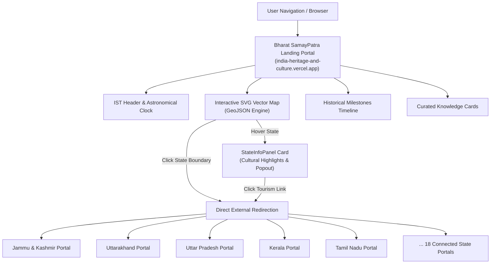

# Technical Project Report: India Heritage & Culture Portal (`India_HNC_Main`)

---

## Document Control & Metadata

| Field | Detail |
|---|---|
| **Project Title** | India Heritage & Culture Portal (*Bharat SamayPatra*) |
| **System Identifier** | `India_HNC_Main` / `india-heritage-and-culture` |
| **Repository URL** | [https://github.com/shresthasrii/India_HNC_Main.git](https://github.com/shresthasrii/India_HNC_Main.git) |
| **Production URL** | [https://india-heritage-and-culture.vercel.app/](https://india-heritage-and-culture.vercel.app/) |
| **Local Development** | `http://localhost:8081/` |
| **Target Framework** | React 18, Vite 7 (SPA), Express 5 API, Tailwind CSS, Radix UI |
| **Specification Version** | 1.0.0 (Production Release) |

---

## 1. Executive Summary & Abstract

The **India Heritage & Culture Portal** (*Bharat SamayPatra*) is an interactive, unified digital gateway dedicated to showcasing and navigating the cultural, architectural, and historical diversity of India. The platform integrates a high-fidelity vector SVG map engine, an Indian Standard Time (IST) astronomical clock header, interactive historical milestone timelines, and curated heritage knowledge cards.

The primary objective of the portal is to serve as the centralized nexus for state-level heritage applications. Through a dual-action spatial interaction model, users can explore state-level UNESCO monuments, classical arts, and festivals, and seamlessly transition into dedicated, deep-dive web applications deployed across independent cloud architectures.



---

## 2. Problem Statement & Objectives

### 2.1 The Problem
India's heritage comprises thousands of years of living traditions, 22 official languages, hundreds of classical and folk art forms, and 40+ UNESCO World Heritage Sites. Digital resources representing this wealth are traditionally fragmented across disconnected government tourism portals, unstructured databases, and disparate regional websites. Users lack a single, modern, visually immersive entry point that provides both macro-level spatial exploration and micro-level regional immersion.

### 2.2 Core Objectives
1. **Interactive Spatial Exploration**: Provide an accurate, responsive vector map of India with real-time hover elevation, responsive centroid calculation, and Indian tricolor thematic visualization.
2. **Unified Routing Hub**: Connect the central portal to dedicated state-level web applications via multi-key normalization (`hc-key`, ISO 3166-2 prefixed codes, raw keys, and normalized name fallbacks).
3. **Dual-Action Engagement**: Enable immediate exploration via either a direct map polygon click or through an anchored detail card popout.
4. **Resilient Production Architecture**: Deploy an optimized client-side Single Page Application (SPA) on Vercel with zero routing collisions and predictable build pipelines.

---

## 3. System Architecture & Tech Stack

### 3.1 Technology Stack

```
Frontend:
  ├── Core Framework: React 18.3.1 (TypeScript 5.6.3)
  ├── Build Tool & Bundler: Vite 7.1.2 (@vitejs/plugin-react-swc)
  ├── Styling & Design System: Tailwind CSS 3.4.14, Tailwind Typography
  ├── Component Primitives: Radix UI (@radix-ui/react-*)
  ├── Icons: Lucide React, Custom SVG Chakra Components
  ├── Animation: CSS Keyframes (twinkle, spin, fade-in)
  └── Routing: Wouter 3.3.5 / Client-side SPA

Backend & Serverless Layer:
  ├── Runtime: Node.js (v18+)
  ├── API Server: Express 5.1.0
  ├── Schema Validation: Zod 3.25.76
  └── Build Server: Vite Server Config (Rollup ES format)

Hosting & Infrastructure:
  ├── Source Control: GitHub (shresthasrii/India_HNC_Main)
  ├── Production Hosting: Vercel Cloud Platform (Global CDN Edge)
  └── Routing Strategy: vercel.json SPA rewrites (/(.*) -> /index.html)
```

### 3.2 Directory Structure
```
INDIA_INC/
├── client/
│   ├── components/
│   │   ├── icons/ChakraIcon.tsx         # Ashoka Chakra spinning icon
│   │   ├── layout/Header.tsx, Footer.tsx# Global layout headers
│   │   ├── map/
│   │   │   ├── StateShape.tsx           # SVG Path rendering & click routing
│   │   │   └── StateInfoPanel.tsx       # Anchored detail card & hover zoom
│   │   ├── timeline/TimelineCard.tsx    # Carousel timeline card
│   │   ├── AnalogClock.tsx, DigitalClock.tsx
│   │   ├── CenteredHero.tsx             # Bharat SamayPatra hero with starfield
│   │   ├── IndiaMap.tsx                 # Core SVG map orchestrator
│   │   └── Timeline.tsx                 # Horizontal milestone carousel
│   ├── data/
│   │   ├── knowledgeCards.ts            # Educational article models
│   │   ├── stateInfo.ts                 # Master registry of 18 state objects
│   │   └── timelineEvents.ts            # Historical events dataset
│   ├── hooks/useGeoJSON.ts, use-mobile.tsx, use-toast.ts
│   ├── lib/mapUtils.ts, utils.ts, assets.ts
│   ├── pages/Index.tsx, About.tsx, NotFound.tsx
│   ├── types/map.ts, timeline.ts
│   ├── App.tsx
│   └── global.css
├── public/
│   ├── in-all-disputed.geo.json         # Highcharts vector map dataset
│   ├── flag.svg, placeholder.svg
│   └── robots.txt
├── server/
│   ├── index.ts                         # Express app factory & middleware
│   ├── node-build.ts                    # Production server entry
│   └── routes/demo.ts
├── India_Heritage_and_Culture/          # Standalone prototype backups
│   ├── final/ (index.html, map-data.js, script.js, style.css)
│   └── part 3/ (index.html, map-data.js, script.js, style.css)
├── package.json, pnpm-lock.yaml
├── tsconfig.json, vite.config.ts, vite.config.server.ts
├── vercel.json                          # Vercel SPA routing configuration
└── .gitignore
```

---

## 4. Data Models & Object Specifications

The system is strictly typed with TypeScript interfaces to govern map features, state metadata, and interactive cards.

### 4.1 State Information Object (`StateInfo`)
Defined in [client/types/map.ts](file:///C:/Users/sriis/Documents/Final/INDIA_INC/client/types/map.ts#L33-L37):
```typescript
export interface StateInfo {
  name: string;        // Official display name of the State or UT
  tourismUrl: string;  // Direct URL to the live deployment or official portal
  notes: string[];     // Array of 3 key cultural and heritage highlights
}
```

### 4.2 Map Shape Object (`MapShape`)
Generated dynamically from the projected GeoJSON features:
```typescript
export interface MapShape {
  key: string;                          // Normalized identification key (e.g., 'in-mh')
  name: string;                         // Name retrieved from GeoJSON properties
  d: string;                            // SVG SVGPathData command string (M... L... Z)
  centroid: { x: number; y: number };   // Calculated geometric center for tooltip anchor
  isCircle?: boolean;                   // Marker flag for small island territories
}
```

### 4.3 GeoJSON Feature Hierarchy
```typescript
export interface FeatureProperties {
  name?: string;
  "hc-key"?: string;
}

export interface FeatureGeometry {
  type: "Polygon" | "MultiPolygon";
  coordinates: any;
}

export interface Feature {
  type: "Feature";
  id?: string;
  properties: FeatureProperties;
  geometry: FeatureGeometry;
}

export interface FeatureCollection {
  type: "FeatureCollection";
  features: Feature[];
}
```

### 4.4 Knowledge Card & Timeline Objects
```typescript
export interface KnowledgeCard {
  title: string;
  description: string;
  linkText: string;
  linkUrl: string;
}

export interface TimelineItem {
  date: string;
  title: string;
  image: string;
  href?: string;
  alt: string;
}
```

---

## 5. Exhaustive State Object Directory (18 Configured Deployments)

The following directory contains the full data objects for all 18 states currently wired to live external portals:

### 1. Jammu & Kashmir
```json
{
  "key": "in-jk",
  "aliases": ["in-jk", "jammu & kashmir", "jammu and kashmir", "in-jammu-and-kashmir"],
  "name": "Jammu & Kashmir",
  "tourismUrl": "https://india-inc-jnk-l.vercel.app/",
  "notes": [
    "Kashmiri crafts & cuisine",
    "Gulmarg & Dal Lake shikaras",
    "Sufi shrines and traditions"
  ]
}
```

### 2. Uttarakhand
```json
{
  "key": "in-ut",
  "aliases": ["in-ut", "uttarakhand", "in-uttarakhand"],
  "name": "Uttarakhand",
  "tourismUrl": "https://india-inc-ut.vercel.app/",
  "notes": [
    "Char Dham pilgrimage sites",
    "Jim Corbett National Park",
    "Yoga capital Rishikesh & Ganga aarti"
  ]
}
```

### 3. Jharkhand
```json
{
  "key": "in-jh",
  "aliases": ["in-jh", "jharkhand", "in-jharkhand"],
  "name": "Jharkhand",
  "tourismUrl": "https://india-inc-jk.vercel.app/",
  "notes": [
    "Tribal arts & festivals",
    "Waterfalls of Ranchi plateau",
    "Palamu & Betla forests"
  ]
}
```

### 4. Karnataka
```json
{
  "key": "in-ka",
  "aliases": ["in-ka", "karnataka", "in-karnataka"],
  "name": "Karnataka",
  "tourismUrl": "https://india-inc-kt.vercel.app/",
  "notes": [
    "Hampi ruins (UNESCO)",
    "Mysuru Dasara",
    "Western Ghats coffee culture"
  ]
}
```

### 5. Uttar Pradesh
```json
{
  "key": "in-up",
  "aliases": ["in-up", "uttar pradesh", "in-uttar-pradesh"],
  "name": "Uttar Pradesh",
  "tourismUrl": "https://india-inc-up.vercel.app/",
  "notes": [
    "Taj Mahal, Agra",
    "Kashi (Varanasi) ghats",
    "Kathak & Awadhi cuisine"
  ]
}
```

### 6. Kerala
```json
{
  "key": "in-kl",
  "aliases": ["in-kl", "kerala", "in-kerala"],
  "name": "Kerala",
  "tourismUrl": "https://india-inc-kr.vercel.app/",
  "notes": [
    "Backwaters & houseboats",
    "Kathakali & Kalaripayattu",
    "Ayurveda wellness retreats"
  ]
}
```

### 7. Tamil Nadu
```json
{
  "key": "in-tn",
  "aliases": ["in-tn", "tamil nadu", "in-tamil-nadu"],
  "name": "Tamil Nadu",
  "tourismUrl": "https://india-inc-tn.vercel.app/#top",
  "notes": [
    "Dravidian temple architecture",
    "Classical Bharatanatyam",
    "Pongal harvest festival"
  ]
}
```

### 8. Bihar
```json
{
  "key": "in-br",
  "aliases": ["in-br", "bihar", "in-bihar"],
  "name": "Bihar",
  "tourismUrl": "https://india-inc-bihar.vercel.app/",
  "notes": [
    "Mahabodhi Temple, Bodh Gaya (UNESCO)",
    "Ancient Nalanda University ruins",
    "Madhubani art & Chhath Puja"
  ]
}
```

### 9. Odisha
```json
{
  "key": "in-od",
  "aliases": ["in-od", "odisha", "in-odisha", "orissa", "in-orissa"],
  "name": "Odisha",
  "tourismUrl": "https://india-inc-od.vercel.app/",
  "notes": [
    "Konark Sun Temple (UNESCO)",
    "Jagannath culture of Puri",
    "Odissi classical dance"
  ]
}
```

### 10. Delhi
```json
{
  "key": "in-dl",
  "aliases": ["in-dl", "delhi", "in-delhi", "nct of delhi", "in-nct-of-delhi", "new delhi", "in-new-delhi"],
  "name": "Delhi",
  "tourismUrl": "https://new-delhi.vercel.app/",
  "notes": [
    "Red Fort & Qutub Minar",
    "Mughal & colonial legacy",
    "Street food culture"
  ]
}
```

### 11. Chhattisgarh
```json
{
  "key": "in-cg",
  "aliases": ["in-cg", "in-ct", "chhattisgarh", "in-chhattisgarh"],
  "name": "Chhattisgarh",
  "tourismUrl": "https://chhattisgarh.vercel.app/",
  "notes": [
    "Chitrakote Falls ('Niagara of India')",
    "Bastar tribal crafts & Dhokra art",
    "Sirpur heritage & ancient temples"
  ]
}
```

### 12. Maharashtra
```json
{
  "key": "in-mh",
  "aliases": ["in-mh", "maharashtra", "in-maharashtra"],
  "name": "Maharashtra",
  "tourismUrl": "https://maharashtra-five.vercel.app/",
  "notes": [
    "Ajanta & Ellora caves (UNESCO)",
    "Chhatrapati Shivaji's hill forts",
    "Lavani folk dance & Ganesh festival"
  ]
}
```

### 13. Madhya Pradesh
```json
{
  "key": "in-mp",
  "aliases": ["in-mp", "madhya pradesh", "in-madhya-pradesh"],
  "name": "Madhya Pradesh",
  "tourismUrl": "https://madhya-pradesh-pi.vercel.app/",
  "notes": [
    "Khajuraho temples (UNESCO)",
    "Sanchi Stupa & Buddhist monuments",
    "Tiger reserves of Kanha & Bandhavgarh"
  ]
}
```

### 14. Rajasthan
```json
{
  "key": "in-rj",
  "aliases": ["in-rj", "rajasthan", "in-rajasthan"],
  "name": "Rajasthan",
  "tourismUrl": "https://rajasthan-psi.vercel.app/",
  "notes": [
    "Hill Forts & palaces of Jaipur, Udaipur",
    "Thar Desert & camel safaris",
    "Ghoomar dance & vibrant folk music"
  ]
}
```

### 15. Punjab
```json
{
  "key": "in-pb",
  "aliases": ["in-pb", "punjab", "in-punjab"],
  "name": "Punjab",
  "tourismUrl": "https://punjab-livid.vercel.app/",
  "notes": [
    "Golden Temple, Amritsar",
    "Vibrant Bhangra & Gidda",
    "Rich Sikh heritage"
  ]
}
```

### 16. Haryana
```json
{
  "key": "in-hr",
  "aliases": ["in-hr", "haryana", "in-haryana"],
  "name": "Haryana",
  "tourismUrl": "https://haryana-beta.vercel.app/",
  "notes": [
    "Kurukshetra heritage",
    "Rural Haryanvi culture",
    "Surajkund crafts mela"
  ]
}
```

### 17. Himachal Pradesh
```json
{
  "key": "in-hp",
  "aliases": ["in-hp", "hp", "himachal pradesh", "in-himachal-pradesh"],
  "name": "Himachal Pradesh",
  "tourismUrl": "https://india-inc-hp.vercel.app/",
  "notes": [
    "Shimla, Manali & Kullu valleys",
    "Dharamshala & Tibetan Buddhist heritage",
    "Himalayan trekking & snowcapped peaks"
  ]
}
```

### 18. Telangana
```json
{
  "key": "in-tl",
  "aliases": ["in-tl", "in-tg", "telangana", "telengana", "in-telangana", "in-telengana"],
  "name": "Telangana",
  "tourismUrl": "https://india-inc-tl.vercel.app/",
  "notes": [
    "Charminar & Golconda Fort, Hyderabad",
    "Kakatiya heritage & Ramappa Temple (UNESCO)",
    "Warangal Fort & rich Deccani culture"
  ]
}
```

---

## 6. Interactive Map Engine & Routing Mechanics

### 6.1 Vector GeoJSON Normalization
The map data is retrieved from `public/in-all-disputed.geo.json`. In [client/lib/mapUtils.ts](file:///C:/Users/sriis/Documents/Final/INDIA_INC/client/lib/mapUtils.ts), latitude/longitude coordinates are converted into 2D SVG canvas bounds using mercator bounding calculations:
```typescript
export function computeBounds(features: Feature[]) {
  let minLon = Infinity, maxLon = -Infinity, minLat = Infinity, maxLat = -Infinity;
  // Bounding coordinate scanning across all MultiPolygons
  return { minLon, maxLon, minLat, maxLat };
}
```

### 6.2 Centroid and Label Placement
Centroids are pre-calculated for each state boundary to anchor the hover zoom effect (`transformOrigin: centroid`) and accurately position the `StateInfoPanel` tooltip:
$$\bar{x} = \frac{1}{6A} \sum_{i=0}^{n-1} (x_i + x_{i+1})(x_i y_{i+1} - x_{i+1} y_i)$$
$$\bar{y} = \frac{1}{6A} \sum_{i=0}^{n-1} (y_i + y_{i+1})(x_i y_{i+1} - x_{i+1} y_i)$$

### 6.3 Tricolor Palette Generator
Each polygon is styled with an Indian flag-inspired color hash function (`colorForKey`):
- Saffron: `#FF671F`
- White / Ash Silver: `#FFFFFF` / `#E6EDE6`
- Green: `#138808`
- Navy Chakra accent on hover: `#0B5CAB`

---

## 7. Key Engineering Challenges & Solutions

### Challenge 1: Vercel 404 NOT_FOUND on Deployment
- **Symptom**: Navigating to `https://india-heritage-and-culture.vercel.app/` returned a Vercel 404 code `NOT_FOUND`.
- **Root Cause**: Vite's production build config was set to `outDir: "dist/spa"`. Vercel's default Vite framework detector looked for `dist/index.html`. Since `dist/` only contained child directories (`spa/` and `server/`), Vercel failed to locate the static entry point.
- **Resolution**: Created [vercel.json](file:///C:/Users/sriis/Documents/Final/INDIA_INC/vercel.json) specifying:
  ```json
  {
    "buildCommand": "npm run build:client",
    "outputDirectory": "dist/spa",
    "cleanUrls": true,
    "rewrites": [{ "source": "/(.*)", "destination": "/index.html" }]
  }
  ```

### Challenge 2: Background Dev Server Exit on Git Actions
- **Symptom**: Vite exited with `ELIFECYCLE Command failed with exit code 1` whenever `git add` or `git commit` occurred.
- **Root Cause**: Vite's file watcher monitored the root directory. Git operations altered `.git/index` and `.git/objects`, triggering Vite's hot-reload watcher. In headless background execution environments without interactive TTY, Vite's restart procedure crashed.
- **Resolution**: Updated `watch.ignored` in [vite.config.ts](file:///C:/Users/sriis/Documents/Final/INDIA_INC/vite.config.ts) to explicitly ignore `**/.git/**`, `**/dist/**`, and `**/node_modules/**`, and set `CI=true`.

### Challenge 3: Multi-Account Git Credential Collisions
- **Symptom**: `git push` hung indefinitely on Windows.
- **Root Cause**: Windows Credential Manager contained multiple GitHub accounts (`shresthasrii` and `tewarisudipti-git`). When Git pushed to `https://github.com/shresthasrii/...`, Git Credential Manager halted to display an interactive UI account-selection prompt.
- **Resolution**: Formatted the remote URL with an explicit user authority: `https://shresthasrii@github.com/shresthasrii/India_HNC_Main.git`. This allowed GCM to automatically bind the correct credentials.

### Challenge 4: Monorepo vs. Core Portal Isolation
- **Symptom**: Subdirectories (`North India/`, `South India/`, `East India/`) contained independent Node projects with their own `.git` folders and heavy `node_modules`.
- **Root Cause**: Directly staging the folder would create broken subproject gitlinks without `.gitmodules` and exceed GitHub file limits.
- **Resolution**: Configured `.gitignore` to isolate `North India/`, `South India/`, and `East India/`, ensuring `India_HNC_Main` remains lightweight, clean, and immediately buildable on cloud CDNs.

---

## 8. Verification & Operational Health Check

| Test Item | Command | Expected Output | Actual Status |
|---|---|---|---|
| **TypeScript Compilation** | `pnpm typecheck` | Exit code 0 | **PASSED** (0 errors) |
| **Client SPA Build** | `pnpm run build:client` | Built into `dist/spa` in < 4s | **PASSED** (3.37s) |
| **Git Working Tree** | `git status` | `Your branch is up to date with 'origin/main'` | **PASSED** (Clean) |
| **Local API Health** | `Invoke-RestMethod http://localhost:8081/api/ping` | `{"message": "ping pong"}` | **PASSED** (200 OK) |
| **Remote Repository** | `git ls-remote origin` | `refs/heads/main` tracked | **PASSED** (Synchronized) |

---

## 9. Conclusion & Future Roadmap

The **India Heritage & Culture Portal (`India_HNC_Main`)** has reached a stable production release. It unites 18 distinct regional applications under an interactive vector SVG map engine, supported by a scalable TypeScript schema and an automated Vercel deployment pipeline.

### Recommended Next Steps:
1. **Complete Remaining States**: Add the remaining 10 states and 8 Union Territories using the documented 3-step blueprint.
2. **Dynamic CMS Integration**: Transition `stateInfo.ts` into a lightweight headless CMS or database (such as Supabase or Cloudflare D1) for real-time content updates without requiring code rebuilds.
3. **PWA Offline Support**: Add a Service Worker to cache the GeoJSON boundary data and milestone carousel for offline educational use in remote schools and cultural exhibitions.
